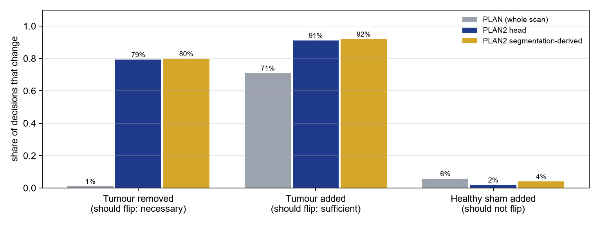
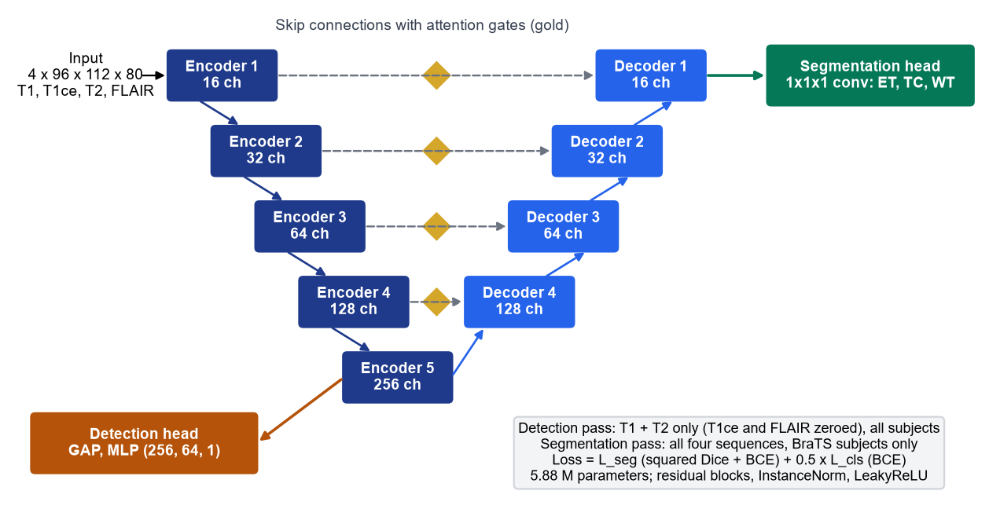
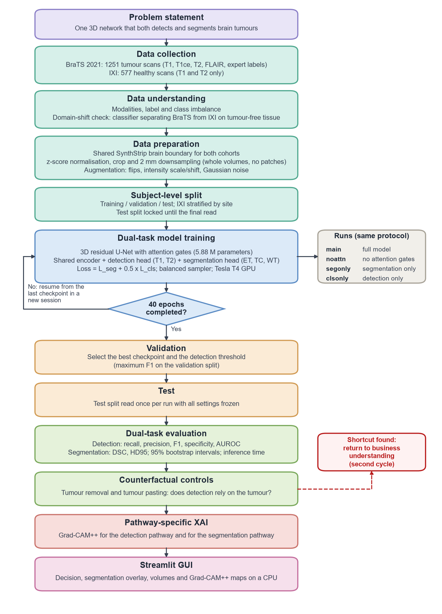
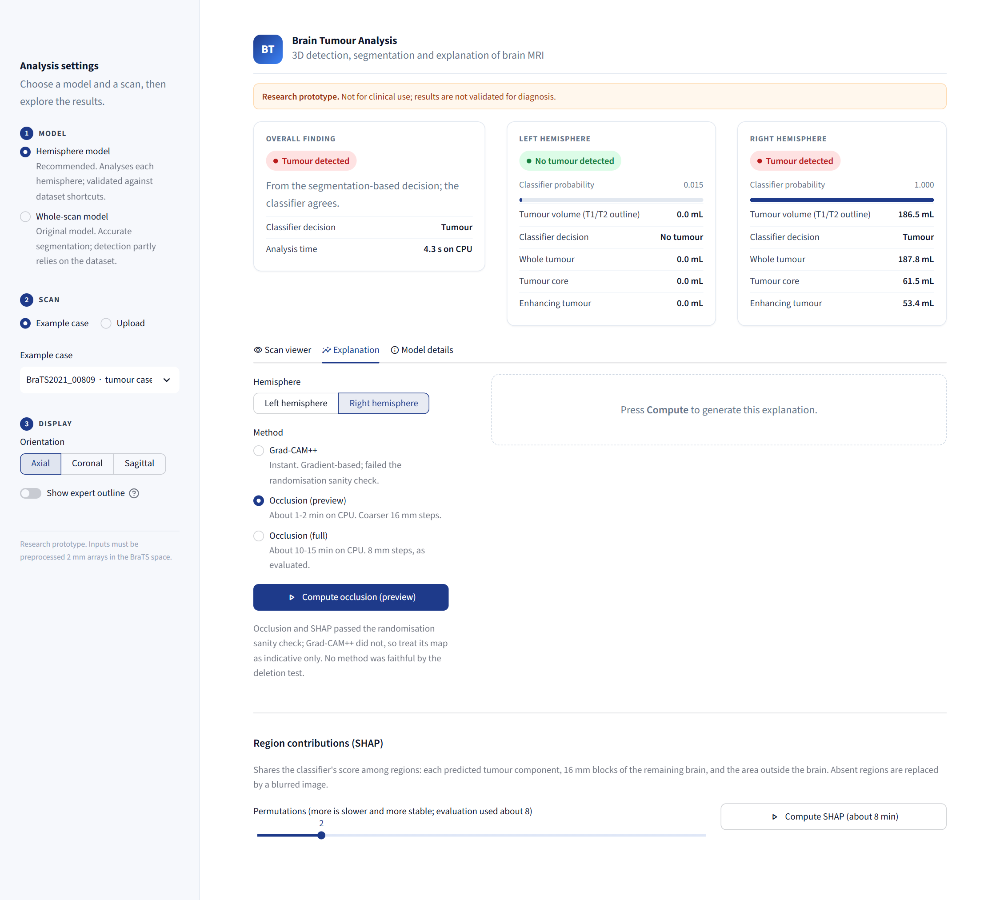
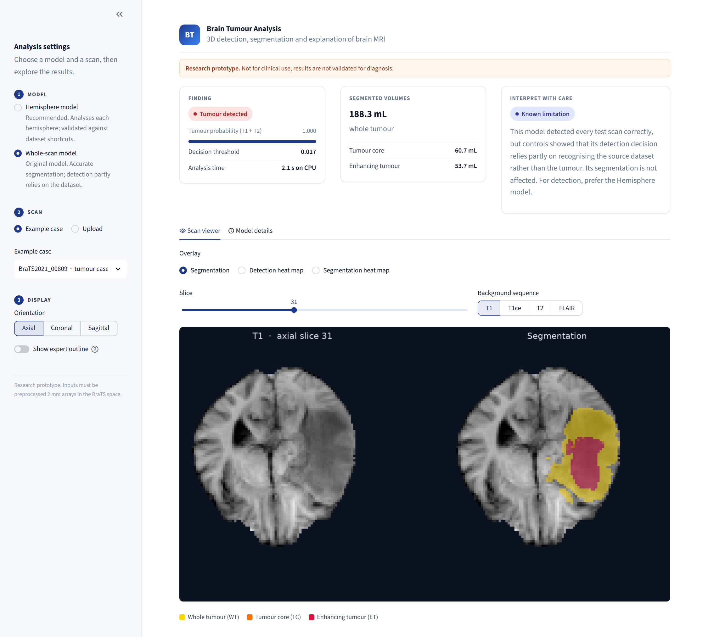

# Brain Tumour Detection and Segmentation using Deep Learning and XAI

A single 3D convolutional neural network that **detects** brain tumours on MRI, **segments** the enhancing tumour (ET), tumour core (TC) and whole tumour (WT), and **explains** its decisions — together with an interactive GUI and a set of pre-registered checks that test whether the model relies on the tumour or on a dataset shortcut.

BSc Honours in Computer Science research project, Sol Plaatje University (2026).
Author: **Tshepiso Promise Lewele** · Supervisor: **Dr. Tite Tuyikeze**

> **Research prototype — not for clinical use.** Results have not been validated for diagnosis.

---

## Highlights

- **One network, two tasks.** A 3D residual U-Net with attention gates (5.88 M parameters) shares one encoder between a detection head and a segmentation head.
- **Two models.**
  - **Model 1 (dual-head, whole scan):** perfect test detection (F1 = 1.000) and DSC 0.849 / 0.900 / 0.921 (ET / TC / WT). Counterfactual controls showed that its detection relied on recognising the *dataset* rather than the tumour: with the tumour removed, 186 of 188 scans were still called tumorous.
  - **SCH-Net — Shortcut-Controlled Hemisphere Network (final model):** analyses each hemisphere, with real and synthetic tumours and healthy-tissue shams in *both* datasets. Test worst-group balanced accuracy 0.945 (segmentation-derived detector), recall 0.932, F1 0.951, WT DSC 0.872, and every pre-registered shortcut check passed.
- **Explainable AI.** Grad-CAM++ (both pathways), occlusion, region SHAP and LIME, compared on localisation, faithfulness (deletion) and a randomisation sanity check.
- **Pre-registration.** The trust checks for SCH-Net and their pass thresholds were committed before training — see the Git tag [`plan2-prereg`](../../tree/plan2-prereg) and [`PLAN2.md`](PLAN2.md).
- **GUI.** A Streamlit app that runs on an ordinary CPU (about 2 s per scan for Model 1).

## Results (test split, read once per model)

| Model | Recall | F1 | Worst-group BA | DSC ET / TC / WT | Median WT HD95 | Shortcut checks |
|---|---|---|---|---|---|---|
| Model 1 (whole scan) | 1.000 | 1.000 | undefined* | 0.849 / 0.900 / 0.921 | 2.8 mm | failed (186/188 still positive without tumour) |
| **SCH-Net**, segmentation-derived detector | 0.932 | 0.951 | **0.945** | 0.773 / 0.807 / 0.872 | 3.5 mm | **all passed** |
| SCH-Net, detection head | 0.915 | 0.942 | 0.937 | (same network) | | behavioural checks passed; saliency localisation failed |

\* Each dataset contains only one class for Model 1, so balanced accuracy within a dataset cannot be computed. SCH-Net is scored per hemisphere; Model 1 per scan. Full tables: [`reports/tables.md`](reports/tables.md) and [`reports/p2/`](reports/p2).

<p align="center"></p>

## Method

<p align="center"></p>

- **Data:** BraTS 2021 Task 1 (1251 glioma scans; T1, T1ce, T2, FLAIR) and IXI (577 healthy scans; T1, T2).
- **Preprocessing:** a shared SynthStrip brain boundary for both cohorts (to reduce the domain gap), z-score normalisation, crop and 2 mm downsampling of whole volumes, subject-level splits (seed 42) with a locked test split.
- **Detection input:** T1 and T2 only, because IXI has no T1ce or FLAIR — otherwise a missing channel would reveal the dataset.
- **Ablations:** no attention gates (`noattn`), segmentation only (`segonly`), detection only (`clsonly`).
- **SCH-Net:** hemisphere samples, synthetic tumour pastes and shams, group-balanced batches, and a segmentation-derived detector (tumour if the segmented volume ≥ 1.544 mL).

<details>
<summary>First-cycle pipeline (Model 1)</summary>
<p align="center"></p>
</details>

## Graphical user interface

| SCH-Net (hemisphere model) | Model 1 (whole-scan model) |
|---|---|
|  |  |

### Run it locally

Requires Python 3.12. The trained weights are included in [`weights/`](weights) (≈ 23 MB each).

```bash
git clone https://github.com/ImTshepi98/brain-tumour-detection-segmentation-xai.git
cd brain-tumour-detection-segmentation-xai
python -m venv .venv
# Windows: .venv\Scripts\activate    macOS/Linux: source .venv/bin/activate
pip install torch --index-url https://download.pytorch.org/whl/cpu
pip install -r requirements.txt
streamlit run app/streamlit_app.py
```

The repository ships two healthy **IXI** example scans in [`examples/`](examples). BraTS scans cannot be redistributed under the BraTS data terms; to view tumour cases, download BraTS 2021 Task 1, preprocess a case with `src/preprocess_one.py` and upload it in the app (or export cases into `data_local/cases/` — see [`docs/PIPELINE.md`](docs/PIPELINE.md)).

## Repository structure

```
app/          Streamlit GUI (streamlit_app.py, hemisphere_view.py, ui.py)
src/          preprocessing, datasets, models, losses, metrics, training, evaluation, XAI, tables
configs/      training configurations (main, noattn, segonly, clsonly, SCH-Net)
kaggle/       one folder per Kaggle kernel (GPU training and evaluation), generators and dry runs
tests/        pytest suite (runs on synthetic data)
reports/      every table and figure produced by the evaluation runs
data_splits/  subject-level train / validation / test split
weights/      trained checkpoints (Model 1 and SCH-Net) with their frozen validation thresholds
examples/     two preprocessed IXI example scans for the GUI
docs/         pipeline details and README images
PLAN.md, PLAN2.md, DECISIONS.md   plan, pre-registered SCH-Net checks, and decision log
```

## Reproducibility

- Seed 42 everywhere; every training run stores a hash of its configuration.
- Checkpoints and thresholds were selected on validation only; the test split was read once per model.
- Training and evaluation ran on Kaggle (NVIDIA Tesla T4). The kernel order, commands and run times are in [`docs/PIPELINE.md`](docs/PIPELINE.md).
- Tests: `python -m pytest -q tests`.

## Data and licences

- **Code:** MIT licence ([`LICENSE`](LICENSE)).
- **BraTS 2021** (RSNA-ASNR-MICCAI): not included. Cite Baid et al. (2021), Menze et al. (2015) and Bakas et al. (2017). *"Data used in this publication were obtained as part of the RSNA-ASNR-MICCAI Brain Tumor Segmentation (BraTS) Challenge project through Synapse ID (syn25829067)."*
- **IXI** (Biomedical Image Analysis Group, Imperial College London, <https://brain-development.org/ixi-dataset/>): CC BY-SA 3.0. The two preprocessed examples in `examples/` are derived from IXI and remain under CC BY-SA 3.0.
- The trained weights were learned from both datasets and are provided for research and education.

## Citation

If you use this work, please cite it (see [`CITATION.cff`](CITATION.cff)):

> Lewele, T. P. (2026). *Brain Tumour Detection and Segmentation using Deep Learning and XAI* (BSc Honours research project, Sol Plaatje University). https://github.com/ImTshepi98/brain-tumour-detection-segmentation-xai
