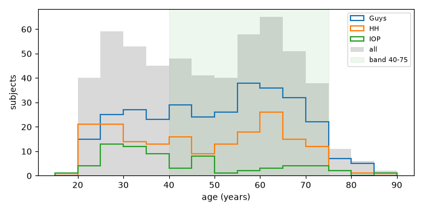

# IXI age table (Phase 3a, 3e)

Source: official `IXI.xls` (`reports/phase0/split-ids/`), 577 paired T1/T2 subjects. Generated by `src/age_tables.py`. Ages: rows without AGE dropped; duplicate IDs averaged when they agree within 1 year, otherwise treated as missing.

**Overall:** 558/577 with age, mean 48.7, SD 16.5, range 20.0-86.3.

Ambiguous (conflicting duplicate rows, age treated as missing): IXI219 [53.08, 58.07]

## By site

|  | n | n_age | mean | sd | min | max |
|---|---|---|---|---|---|---|
| Guys | 319 | 310 | 50.8 | 15.9 | 20.1 | 86.2 |
| HH | 185 | 181 | 47.4 | 16.7 | 20.2 | 81.9 |
| IOP | 73 | 67 | 42.5 | 16.7 | 20.0 | 86.3 |

## By split

|  | n | n_age | mean | sd | min | max |
|---|---|---|---|---|---|---|
| test | 87 | 84 | 49.8 | 16.1 | 20.2 | 86.2 |
| train | 404 | 392 | 48.3 | 16.6 | 20.0 | 86.3 |
| val | 86 | 82 | 49.2 | 16.3 | 20.1 | 79.4 |

## 10-year bands (subjects with age)

|  | Guys | HH | IOP | all |
|---|---|---|---|---|
| 20-29 | 40 | 42 | 17 | 99 |
| 30-39 | 50 | 27 | 21 | 98 |
| 40-49 | 53 | 25 | 11 | 89 |
| 50-59 | 64 | 31 | 3 | 98 |
| 60-69 | 68 | 41 | 7 | 116 |
| 70-79 | 29 | 14 | 6 | 49 |
| 80-89 | 6 | 1 | 1 | 8 |
| <20 | 0 | 0 | 1 | 1 |

## Age band for Phase 6 (3e): 40 to 75 years inclusive

|  | test | train | val | all |
|---|---|---|---|---|
| inside | 53 | 234 | 54 | 341 |
| no age | 3 | 12 | 4 | 19 |
| outside | 31 | 158 | 28 | 217 |

